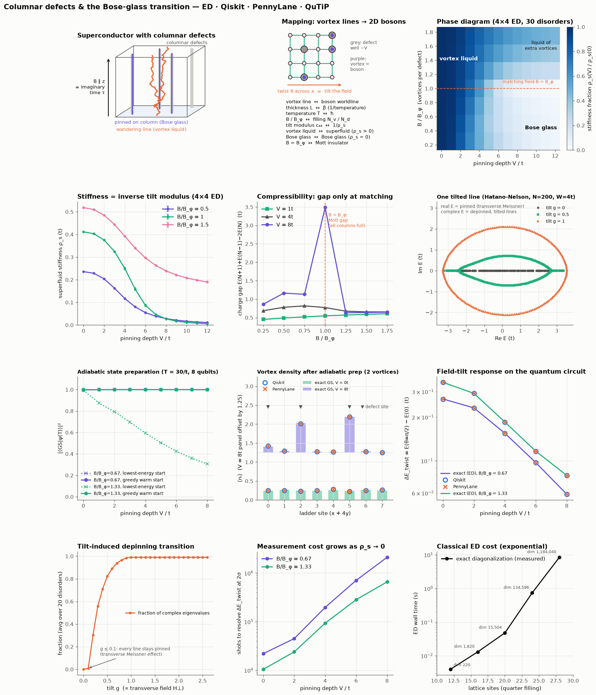

# quantum_computing_examples

Physics models solved with quantum-computing libraries (Qiskit, PennyLane, QuTiP)
and checked against a classical exact solution. Every example saves a figure and
reports how far the quantum result is from the exact one.

| Example | Model | Libraries | Check |
|---|---|---|---|
| [`bose_glass_columnar/`](bose_glass_columnar/) | Superconductor with columnar defects → Bose glass | exact diagonalization, Qiskit, PennyLane, QuTiP | twist energy, circuits vs ED: 8.5e-4 |
| [`pasqal/`](pasqal/) | Neutral atoms: first job, Rydberg Z2 crystal, Maximum Independent Set | Pulser, Pasqal Cloud, QuTiP, Qiskit | all three **PASS on Pasqal Cloud's free emulator EMU_FREE** (not a real QPU) |

More examples will be added.

## Setup

```bash
python3.12 -m venv .venv
source .venv/bin/activate
pip install -r requirements.txt
```

## Superconductor with columnar defects → Bose glass

```bash
cd bose_glass_columnar
python bose_glass_columnar.py        # about 5 minutes on a laptop CPU, writes bose_glass_columnar.png
```



### Physics

Heavy-ion tracks (or self-assembled nanorods) form columnar defects along the field
direction of a type-II superconductor. They pin vortex lines. Nelson and Vinokur showed
that the statistical mechanics of these lines is the imaginary-time path integral of
2D quantum bosons:

| Vortex lines in 3D | 2D quantum bosons |
|---|---|
| vortex line | boson worldline |
| sample thickness L | inverse temperature β |
| temperature T | ħ |
| columnar defect | static random potential well −V |
| B / B_φ | filling N_v / N_d |
| field tilt H⊥ | twist θ (vector potential) |
| tilt modulus c₄₄ | 1 / superfluid stiffness ρ_s |
| vortex liquid | superfluid (ρ_s > 0) |
| pinned lines | Bose glass (ρ_s = 0) |
| B = B_φ | Mott insulator |

The lattice model is hard-core bosons, which map one-to-one onto qubits (|1⟩ = vortex present):

H = −t Σ⟨ij⟩ (e^{iφᵢⱼ} b⁺ᵢ bⱼ + h.c.) + Σᵢ εᵢ nᵢ

where εᵢ is weak point disorder plus a well −V(0.8…1.2) on the defect sites.

### What the script computes

- **Classical exact diagonalization (the baseline).** A 4×4 torus with 4 defects and
  N_v = 1…7, averaged over disorder. It gives the phase diagram from the stiffness
  ρ_s = 2 ΔE(θ)/θ², and the charge gap, which opens only at the matching field B = B_φ.
- **Quantum circuits on 8 qubits (2×4 ladder).** Qiskit and PennyLane both run
  Trotterized adiabatic state preparation, then a slow twist ramp θ: 0 → π/2, which
  plays the role of a field tilt. The twist energy is compared with ED and with
  QuTiP `sesolve`.
- **Single tilted line (Hatano–Nelson).** Non-Hermitian hopping models a transverse
  field. Its eigenvalues turn complex when the line depins.
- **Cost panels.** Shots needed to resolve the twist energy grow as ρ_s → 0. ED time
  grows exponentially with lattice size.

### Results

- Quantum circuits vs ED, twist energy: max error **8.5e-4 t**. Vs QuTiP: **2.3e-3 t**.
  Qiskit and PennyLane agree with each other.
- **Honest note.** A plain adiabatic ramp from the lowest-energy product state fails
  above the matching field (fidelity 0.3 at V = 8t), because of near level crossings.
  A greedy classical warm start fixes it: put the extra vortex on the free site that
  has the most empty neighbours. Trotter error scales with V·dt, so dt = 0.05 is used.
- **Measurement cost.** Deep in the Bose glass the signal ΔE_twist is about 0.06 t,
  which needs roughly 10⁶ shots to resolve at 2σ. This is where a real device would struggle.

### Where this physics shows up elsewhere

- **Superconducting tape for high-field magnets.** BaZrO₃ nanorods in REBCO coated
  conductors act as columnar pins
  ([Sci. Rep. 2017](https://www.ncbi.nlm.nih.gov/pmc/articles/PMC5537340/)).
- **Ultracold atoms.** The 2D Bose glass was observed in an optical quasicrystal
  ([Nature 2024, arXiv:2303.00737](https://arxiv.org/abs/2303.00737)). An earlier 1D
  experiment is [Fallani et al. 2007](https://arxiv.org/abs/cond-mat/0603655).
- **Quantum magnets.** Magnons in Br-doped DTN behave as disordered bosons
  ([arXiv:1109.4403](https://arxiv.org/abs/1109.4403),
  [PRL 121, 177202](https://link.aps.org/doi/10.1103/PhysRevLett.121.177202)).
- **Non-Hermitian physics.** The Hatano–Nelson model is the standard example of the
  non-Hermitian skin effect, realized in photonic and electric-circuit experiments
  ([arXiv:2306.13454](https://arxiv.org/abs/2306.13454)).

## License

[MIT](LICENSE)
