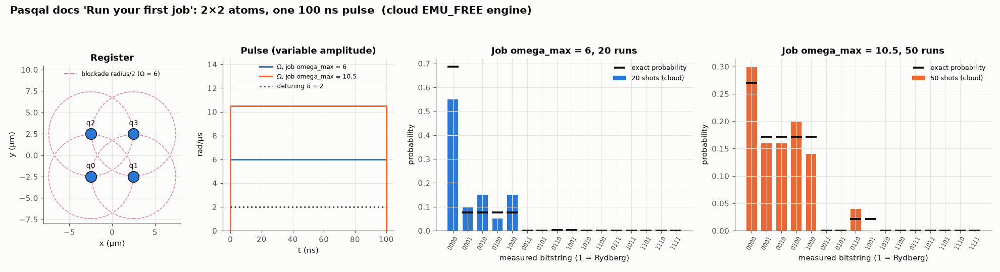
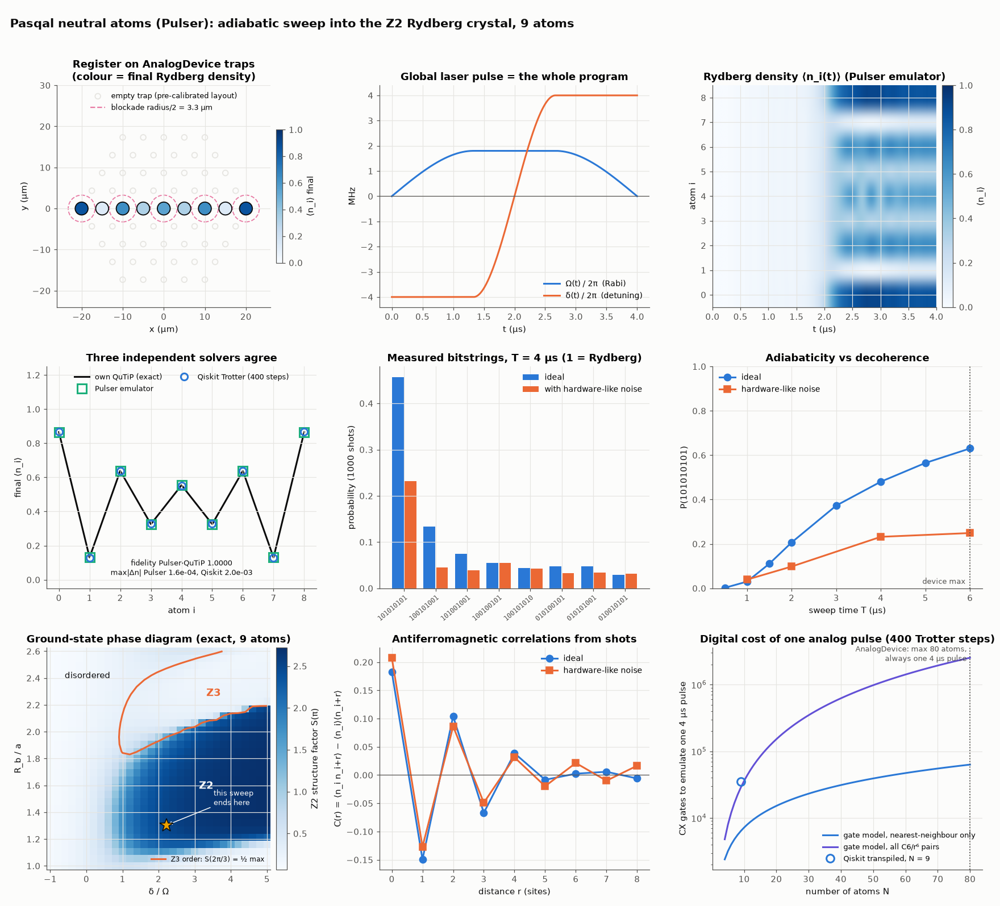
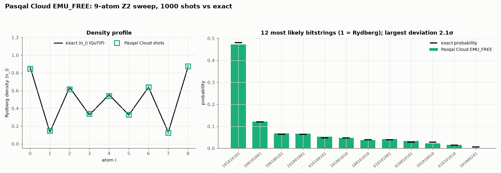
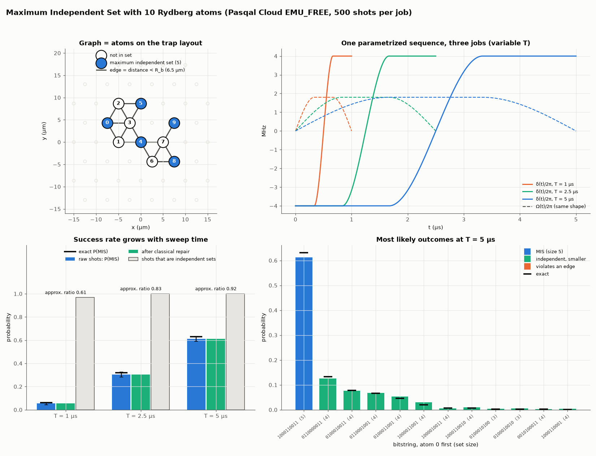
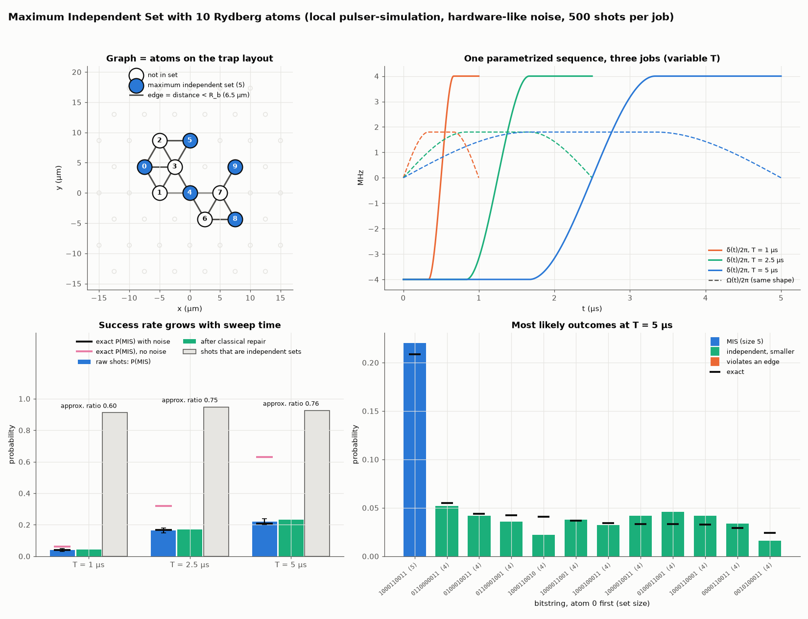

# Neutral atoms on Pasqal (Pulser + Pasqal Cloud)

> **What "cloud" means here.** The cloud results below were sent to Pasqal Cloud and
> computed by its free emulator **EMU_FREE** (Explorer plan). They were **not** run on a
> real QPU. The submission path, sequence format and result format are the same ones a QPU
> job uses. QPU time (FRESNEL) needs a contract or a paid plan.

Pasqal's QPUs are **analog**: you do not write gates. You place atoms in optical tweezers
and shape one global laser pulse, Rabi frequency Ω(t) and detuning δ(t). The atoms then
evolve under

H(t) = Ω/2 Σ X_i − δ Σ n_i + Σ C6/r_ij⁶ n_i n_j

Two atoms closer than the blockade radius R_b = (C6/Ω)^(1/6) cannot both be excited.

| Script | What it does | Local check | Pasqal Cloud EMU_FREE |
|---|---|---|---|
| `pasqal_first_job.py` | Pasqal docs "Run your first job": 2×2 atoms, one 100 ns pulse, a batch of two jobs | within 2.9σ of exact | batch `dfc13361…`: within 1.3σ, **PASS** |
| `pasqal_rydberg.py` | 9-atom chain, adiabatic sweep into the Z2 crystal `101010101`; Pulser vs QuTiP vs Qiskit Trotter; noise, phase diagram, CX cost | fidelity 1.0000, Qiskit max\|Δn\| 2.0e-3 | batch `13450df9…`: P(Z2) 0.472 vs exact 0.480, 2.1σ, **PASS** |
| `pasqal_mis.py` | Maximum Independent Set on a 10-atom unit-disk graph, solved by an adiabatic sweep | noiseless and noisy, **PASS** | batch `f3f82c9d…`: P(MIS) 0.054 / 0.304 / 0.612 vs exact 0.061 / 0.319 / 0.631, **PASS** |

## Run

```bash
pip install -r ../requirements.txt
python pasqal_first_job.py            # local, seconds
python pasqal_rydberg.py              # local, about 12 min (30 noise trajectories x 4 sweep times)
python pasqal_mis.py                  # local, noiseless
python pasqal_mis.py --noise          # local, with noise (uses the cached pasqal_mis_noisy_reference.json)
```

**Cloud mode.** Create a free account at <https://portal.pasqal.cloud> and note your
project id. Then add `--mode cloud`:

```bash
python pasqal_mis.py --mode cloud
```

The script asks for your username, project id and password. The password is read hidden
and is never stored. The `PASQAL_USERNAME` and `PASQAL_PROJECT_ID` environment variables
skip the first two prompts.

## 1. First job (Pasqal docs)



The sequence and both jobs are copied from <https://docs.pasqal.com/cloud/first-job/>.
The figure shows the cloud counts against the exact probabilities.

## 2. Rydberg chain → Z2 crystal




- **Sweep.** 9 atoms 5 µm apart on the pre-calibrated `AnalogDevice` layout,
  R_b = 6.5 µm. δ sweeps from −2π·4 to +2π·4 MHz over 4 µs.
- **Three solvers agree.** Pulser emulator vs an independent QuTiP solve: fidelity
  1.0000. Qiskit 2nd-order Trotter circuit vs QuTiP: max|Δn| 2.0e-3. P(Z2) = 0.48 in all.
- **Noise.** With the illustrative noise model, P(Z2) is 0.04 / 0.10 / 0.23 / 0.25 for
  sweeps of 1 / 2 / 4 / 6 µs, so slower sweeps stop helping.
- **Cost.** One 4 µs analog pulse corresponds to about 3.4·10⁴ CX gates for 9 atoms.
  This is the practical case for analog hardware on these models, not a proven quantum
  advantage: 9 atoms are easy to simulate classically.
- `pasqal_rydberg_sequence.json` is the exported sequence, the same file a QPU job takes.

## 3. Maximum Independent Set (MIS)




- **Problem.** 10 atoms in the trap layout, 15 edges (pairs closer than R_b). The unique
  MIS has size 5: `1000110011`. It was checked by classical brute force over 1024 subsets.
- **How it is solved.** The blockade makes the ground state of the sweep's final
  Hamiltonian an independent set with the most excitations. A slow sweep finds it more
  often.
- **Score.** "Repair" drops violating excitations classically. The approximation ratio
  is ⟨|S|⟩ / |MIS|.

| Sweep time | P(MIS), no noise (exact) | P(MIS), cloud | P(MIS), with noise (exact) | P(MIS), with noise (local, 500 shots) |
|---|---|---|---|---|
| 1 µs | 0.061 | 0.054 | 0.039 | 0.040 |
| 2.5 µs | 0.319 | 0.304 | 0.166 | 0.164 |
| 5 µs | 0.631 | 0.612 | 0.208 | 0.220 |

With noise the gain from a slower sweep mostly disappears after 2.5 µs, because
dephasing builds up. Even so the MIS appears about 200 times more often than a random
guess (1/1024). The noise values (dephasing 0.2, relaxation 0.01, false positive 0.01,
false negative 0.05) are illustrative and are not a device calibration. The noisy run
has not been sent to the cloud yet.
